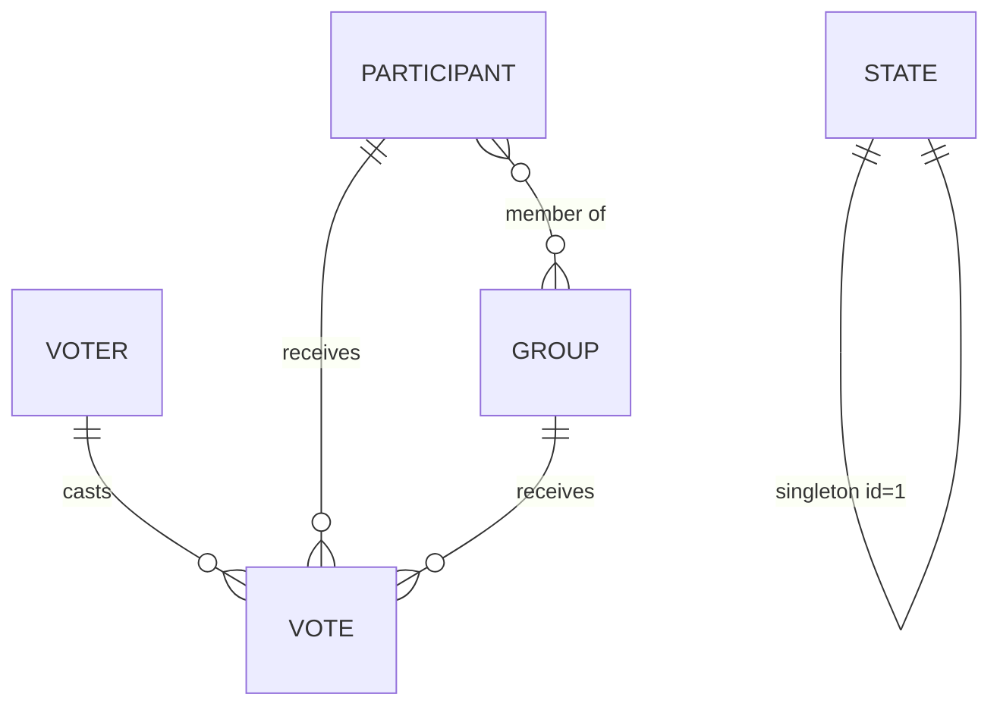

# 02. Техническое задание

Сервис голосования конкурса хеллоуинских костюмов «Тыквоголос» · версия 1.0 · 2026-11-04

> Термины — в глоссарии ([01-Анализ.md §12](01-Анализ.md)). Решения D-*, E-* — из каталога анализа (§8).

---

## 1. Общие сведения

**Назначение системы:** веб-сервис для анонимного голосования гостей мероприятия за костюмы в 4 номинациях и гран-при, с админ-панелью для управления справочниками, состоянием голосования, результатами и экспортом.

**Границы системы:** одностраничный поток голосования (server-rendered + fetch API), админ-панель, REST-эндпоинты голосования, healthcheck. Внешние интеграции: только managed PostgreSQL (Neon) и опциональный пингер-аптайм (cron-job.org/UptimeRobot).

**Срок:** разработка — 2 дня (T-2, T-1), запуск — T-1 вечер, мероприятие — T.

## 2. Архитектура (обзор)

```
┌──────────────┐   HTTPS    ┌─────────────────────────────┐      ┌──────────────────┐
│ Гость (тел.) │──────────▶│  Render free web service    │─────▶│ Neon free        │
└──────────────┘            │  Django 5.2 (Gunicorn,      │      │ PostgreSQL 16    │
┌──────────────┐            │  WhiteNoise, шаблоны+JS)    │      │ (pooled conn.)   │
│ Админ (ноут) │──────────▶│  /  — поток голосования     │      └──────────────────┘
└──────────────┘            │  /api/v1/* — отправка голоса│
┌──────────────┐            │  /admin/* — админ-панель    │      ┌──────────────────┐
│ Пингер 5 мин │──────────▶│  /healthz — прогрев         │      │ cron-job.org /   │
└──────────────┘            └─────────────────────────────┘      │ UptimeRobot      │
                                                                  └──────────────────┘
```

Монолит на Django: модели + представления + шаблоны + минимум ванильного JS. Никаких сборщиков фронта, никаких очередей и воркеров — масштаб их не требует.

## 3. Роли и модель доступа

| Роль | Аутентификация | Доступ |
|---|---|---|
| Гость | нет (анонимный voter-токен в httpOnly-cookie `voter_token`, 30 дней, + дубль в localStorage) | `/` — поток голосования в зависимости от состояния |
| Админ | логин+пароль из env (`ADMIN_LOGIN`/`ADMIN_PASSWORD`), Django-session cookie (httpOnly, Secure) | `/admin/*`: дашборд, справочники, состояние, результаты, экспорт, опасная зона |

Троттлинг логина: 5 неудачных попыток с IP → блокировка 10 минут (кэш Django). Все админ-страницы — только за логином; 401/редирект на `/admin/login/`.

> Примечание к требованию «../admin»: трактуем как корневой путь `/admin` относительно домена. Django admin (встроенный) остаётся на `/django-admin/` как аварийный бэкдор (доступ только superuser'у из env-инициализации).

## 4. Функциональные требования

### 4.1 Поток голосования (модуль М1, М2)

**FR-V-01. Вход сразу в голосование.** При открытии `/` гость без каких-либо промежуточных шагов видит либо активный поток голосования, либо экран текущего состояния (НЕ НАЧАТО / ПАУЗА / ЗАВЕРШЕНО / «Вы уже проголосовали»). *Критерий: от открытия URL до первой карточки номинации — 0 промежуточных экранов.*

**FR-V-02. Идентификация без регистрации.** При первом визите сервер создаёт запись `Voter` с UUID-токеном и отдаёт его в httpOnly-cookie (30 дней, SameSite=Lax, Secure). Клиент дополнительно дублирует токен в localStorage. Никаких форм ввода данных гостя. *Критерий: повторный визит с того же браузера узнаётся и без cookie (по localStorage-токену, передаётся в заголовке `X-Voter-Token`).*

**FR-V-03. Четыре номинации + гран-при.** Поток: 5 шагов-категорий в фиксированном порядке: «Самый страшный» → «Самый смешной» → «Самый оригинальный» → «Лучший групповой костюм» → «Лучший костюм всего вечера (гран-при)». Шаги 1–3 показывают активных участников, шаг 4 — активные группы, шаг 5 — активных участников и группы (секции с бейджами «Соло»/«Группа»). Прогресс-индикатор (5 сегментов-тыкв) виден на всех шагах.

**FR-V-04. Выбор в пару кликов.** Каждый шаг: сетка карточек (фото или плейсхолдер, номер, имя). Тап по карточке = выбор (мгновенная визуальная подсветка), кнопка «Далее» переводит на следующий шаг. Кнопка «Пропустить» — без голоса в этой номинации. *Критерий: полный проход 5 номинаций без фото-рассматривания ≤60 с; голос в одной номинации = ровно 2 тапа.*

**FR-V-05. Уникальность кандидата между номинациями.** Кандидат, выбранный в одной из 4 номинаций, на последующих шагах отображается приглушённым с бейджем «Уже выбран: <название номинации>» и некликабелен. Сервер независимо валидирует: один кандидат — не более одной номинации (кроме гран-при). *Критерий: попытка обойти UI через devtools/API отклоняется 422 с указанием конфликта.*

**FR-V-06. Гран-при независим.** В гран-при можно выбрать любого активного кандидата (участника или группу), включая уже выбранного в номинации. Не более одного выбора.

**FR-V-07. Возврат и черновик.** До подтверждения можно вернуться «Назад» и изменить любой выбор. Черновик (выборы + текущий шаг) хранится в localStorage и восстанавливается при перезагрузке/повторном открытии. Черновик НЕ является голосом.

**FR-V-08. Подтверждение и атомарная отправка.** Шаг «Проверь себя»: сводка выборов по 5 строкам (с миниатюрами) + кнопка «Подтвердить голос 🎃» + honeypot-поле (скрытое `website`, должно быть пустым). Отправка — один `POST /api/v1/vote` со всеми выборами; сервер в одной транзакции валидирует правила (состояние ACTIVE, токен не голосовал, уникальность, активность кандидатов, honeypot) и записывает все голоса. Частичная запись невозможна.

**FR-V-09. Экран успеха.** После подтверждения: полноэкранный «Голос учтён!» — благодарность, анимация (летучие мыши/конфетти), текст «Изменить голос нельзя», номер/статистика «Вас уже N проголосовавших». Cookie+БД помечают voter как проголосовавшего.

**FR-V-10. Повторное голосование заблокировано (мягко).** Визит проголосовавшего токена (cookie или localStorage) → экран «Вы уже проголосовали 🎃 Ваши голоса учтены. Спасибо!» без возможности голосовать снова. С другого устройства/инкогнито — новый токен (принятый риск, см. анализ §7).

**FR-V-11. Экраны состояний.** НЕ НАЧАТО / ПАУЗА / ЗАВЕРШЕНО — отдельные экраны с брендовым оформлением и микротекстами (см. айдентику §9). При ЗАВЕРШЕНО и включённой публикации — кнопка «Посмотреть результаты» → публичная страница `/results` (только сводные диаграммы, без деталей по голосующим).

**FR-V-12. Rate-limit.** Не более 10 отправок `/api/v1/vote` в минуту с IP + мгновенный отказ уже проголосовавшему токену (409).

### 4.2 Состояние голосования (модуль М3)

**FR-S-01. Статус-машина.** Состояния: `NOT_STARTED` (по умолчанию при развёртывании), `ACTIVE`, `PAUSED`, `FINISHED`. Допустимые переходы: NOT_STARTED→ACTIVE; ACTIVE⇄PAUSED; ACTIVE→FINISHED; PAUSED→FINISHED. FINISHED терминально (выход только через сбросы опасной зоны). Переходы назад из FINISHED запрещены (E8).

**FR-S-02. Двойное подтверждение переходов.** Кнопка перехода открывает модалку: описание последствий + контрольная фраза, которую нужно ввести (регистронезависимо): старт — `НАЧАТЬ`, пауза — `ПАУЗА`, продолжение — `ПРОДОЛЖИТЬ`, завершение — `ЗАВЕРШИТЬ`. Кнопка применения неактивна, пока фраза не совпала. Все переходы пишутся в журнал админа.

**FR-S-03. Поведение потока голосования по состояниям.** Голосовать (открывать шаги и отправлять) можно только в ACTIVE. В PAUSED черновики сохраняются, отправка отклоняется 409 с сообщением «Голосование на паузе». В NOT_STARTED/FINISHED API отправки отклоняется 409.

### 4.3 Админ-панель: справочники (модуль М4)

**FR-A-01. Дашборд `/admin/`.** Текущее состояние (крупный бейдж + кнопки переходов с двойным подтверждением), счётчики: участников, групп, проголосовавших, голосов по номинациям, мини-график активности по часам, быстрые ссылки, блок аномалий (если `голосов с одного IP-хэша > порога`). Автообновление счётчиков раз в 30 с (fetch).

**FR-A-02. Участники `/admin/participants/`.** Список (фото, номер, имя, статус, голоса-по-номинациям сводно), поиск. Создание/редактирование: имя* (≤100), номер (авто-инкремент, редактируемый, уникальный), описание (≤300, опц.), фото (опц., ≤5 МБ, jpg/png/webp → ресайз Pillow до 640 px, quality 80, хранение в БД). Удаление — мягкое (`is_active=false`) с предупреждением, если есть голоса; «восстановить» из списка с фильтром «архив». Предпросмотр карточки «глазами гостя».

**FR-A-03. Группы `/admin/groups/`.** Список + CRUD: название*, номер (авто), описание, фото, состав — мультивыбор из активных участников (валидация E9: участник не может входить в две активные группы). Мягкое удаление аналогично FR-A-02.

**FR-A-04. Порядок карточек.** В потоке голосования карточки сортируются по номеру. Номера задаёт админ — ими же управляет порядком.

### 4.4 Результаты и диаграммы (модуль М5)

**FR-R-01. Страница результатов `/admin/results/`.** По каждой из 5 категорий: таблица «место / кандидат / голосов / % от проголосовавших» + встроенная столбчатая диаграмма (Chart.js, вендорится локально, цвета категорий из айдентики §4). Сводка: всего проголосовавших, явка по номинациям (кто сколько пропустил).

**FR-R-02. Полноэкранная диаграмма.** У каждой диаграммы кнопка «⛶ На весь экран» → отдельная страница `/admin/charts/<slug>/` (slug: `scary`, `funny`, `original`, `group`, `grandprix`, `summary`): тёмный фон, огромная диаграмма, название номинации, топ-3 с номерами, кнопка Fullscreen API + подсказка про F11. Страница пригодна для проектора на объявлении победителей (доступ по админ-сессии; для проектора с ноутбука организатора — норм).

**FR-R-03. Публикация результатов (Should).** После FINISHED переключатель «Опубликовать результаты гостям» → публичный `/results` со сводными диаграммами (без журнала, без токенов).

### 4.5 Экспорт (модуль М6)

**FR-E-01. `/admin/export/`** — кнопки скачивания: `votes.csv` (метка времени UTC, категория, тип и имя кандидата, короткий хэш токена — первые 8 символов), `participants.csv`, `groups.csv`, `results-summary.csv` (итоговые таблицы), `results.json` (всё вместе). CSV — UTF-8 с BOM (открывается в Excel без танцев).

### 4.6 Опасная зона (модуль М7)

**FR-D-01. `/admin/danger/`** — визуально выделенная зона (красная рамка, предупреждающий текст):
- **«Сбросить голоса»**: удаляет все `Vote`, обнуляет `voted_at` у voter'ов, состояние → NOT_STARTED (участники/группы сохраняются). Двойное подтверждение: модалка с перечислением последствий + фраза `СБРОС ГОЛОСОВ` + рекомендация «сначала сделайте экспорт».
- **«Полный сброс»**: удаляет голоса, участников, группы, voter'ов, журнал; состояние → NOT_STARTED. Фраза `ПОЛНЫЙ СБРОС`.
**FR-D-02.** Оба действия пишутся в журнал (журнал при полном сбросе очищается последним, с записью-эпитафией в лог-файл сервера).

## 5. Модель данных



| Сущность | Поля (ключевые) |
|---|---|
| `Participant` | id, number (unique), name, description, photo_data (binary, nullable), photo_mime, is_active, created_at, updated_at |
| `Group` | id, number (unique), name, description, photo_data, photo_mime, is_active, participants (M2M), created_at |
| `Voter` | token (UUID, PK), created_at, voted_at (nullable), ip_hash (sha256, первые 16), user_agent (≤255) |
| `Vote` | id, voter (FK), category (SCARY/FUNNY/ORIGINAL/GROUP/GRANDPRIX), subject_type (PARTICIPANT/GROUP), participant (FK nullable), group (FK nullable), created_at. Ограничения: `UNIQUE(voter, category)`; CHECK — ровно один из participant/group в соответствии с subject_type; CHECK — category=GROUP ⇔ subject_type=GROUP |
| `State` (singleton) | id=1, state (NOT_STARTED/ACTIVE/PAUSED/FINISHED), updated_at, publish_results (bool), allow_skip (bool, default true), grandprix_includes_groups (bool, default true), soft_ip_limit (int, default 0=выкл) |
| `AdminLog` | id, action (str), details (json), created_at |

Фото в БД (не в файловой системе) — осознанно: free-тариф Render не даёт постоянный диск (E6). Объём: ~38 субъектов × ~100 КБ ≈ 4 МБ — лимит Neon 1 ГБ с запасом.

## 6. Карта URL и API

| Метод | URL | Назначение |
|---|---|---|
| GET | `/` | Поток голосования / экран состояния / «уже проголосовал» |
| GET | `/photo/p/<id>.jpg`, `/photo/g/<id>.jpg` | Фото из БД (Cache-Control: max-age=86400, ETag) |
| GET | `/healthz` | Пингер: `SELECT 1` (греет Render и Neon), 200 `ok` |
| GET | `/results` | Публичные результаты (только если FINISHED + publish_results) |
| POST | `/api/v1/vote` | Отправка голоса |
| GET | `/api/v1/stats` | Счётчик проголосовавших (для экрана успеха и дашборда) |
| GET/POST | `/admin/login/`, `/admin/logout/` | Аутентификация админа |
| GET | `/admin/` | Дашборд |
| CRUD | `/admin/participants/…`, `/admin/groups/…` | Справочники |
| POST | `/admin/state/` | Переходы состояния (двойное подтверждение на клиенте + проверка на сервере) |
| GET | `/admin/results/`, `/admin/charts/<slug>/` | Результаты, полноэкранные диаграммы |
| GET | `/admin/export/<what>/` | Скачивание CSV/JSON |
| GET/POST | `/admin/danger/` | Опасная зона |
| GET | `/admin/qr/` | Печать QR-кодов (Should) |

**`POST /api/v1/vote`** — запрос:
```json
{
  "token": "uuid (из localStorage, если cookie нет)",
  "votes": [
    {"category": "SCARY", "subject_type": "PARTICIPANT", "subject_id": 3},
    {"category": "GROUP", "subject_type": "GROUP", "subject_id": 1}
  ],
  "grandprix": {"subject_type": "PARTICIPANT", "subject_id": 7},
  "website": ""
}
```
Ответы: `200 {"status":"ok","voters_total":42}` · `409 {"error":"already_voted"|"not_active"|"paused"}` · `422 {"errors":[{"code":"conflict","category":"FUNNY","subject_id":3}]}` · honeypot непустой → `400`.

## 7. Экраны (wireframes)

```
┌ / (ACTIVE, шаг 2/5) ─────────────┐   ┌ / (подтверждение) ───────────────┐
│ 🎃 Тыквоголос            2/5 ●●○○○│   │ Проверь свой выбор 🕯️            │
│ САМЫЙ СМЕШНОЙ КОСТЮМ              │   │ Страшный   → №3 Кощей            │
│ ┌───────┐ ┌───────┐ ┌───────┐   │   │ Смешной    → №7 Тыква-босс       │
│ │ foto  │ │ foto🔒│ │ foto  │   │   │ Оригинал   → пропущено           │
│ │ №5    │ │ №6    │ │ №7    │   │   │ Группа     → №1 Семейка Аддамс   │
│ │Имя    │ │(выбран│ │Имя    │   │   │ Гран-при   → №7 Тыква-босс       │
│ └───────┘ │ в №1) │ └───────┘   │   │ ┌────────────────────────────┐  │
│ [ Назад ]  [Пропустить] [Далее→] │   │ │   ПОДТВЕРДИТЬ ГОЛОС 🎃     │  │
└──────────────────────────────────┘   │ └────────────────────────────┘  │
                                        └──────────────────────────────────┘
┌ / (успех) ────────────────────────┐  ┌ /admin/ (дашборд) ──────────────┐
│        👻  🦇   🦇                 │  │ СОСТОЯНИЕ: ● АКТИВНО            │
│   ГОЛОС УЛЕТЕЛ В КОТЁЛ!           │  │ [Пауза] [Завершить]             │
│   Ваши голоса учтены.             │  │ Голосовало: 42 / ~100           │
│   Изменить выбор нельзя.          │  │ Страшный 12·Смешной 9·Ориг 11   │
│   Вас уже 42 проголосовавших      │  │ Группа 8·Гран-при 10            │
│        Спасибо! 🎃                │  │ → Участники → Группы → Результаты│
└───────────────────────────────────┘  │ → Экспорт → ОПАСНАЯ ЗОНА ⚠      │
                                        └─────────────────────────────────┘
```

## 8. Нефункциональные требования

| Класс | Требование | Метрика / проверка |
|---|---|---|
| Производительность | Время первого экрана | ≤2 с на 3G; вес HTML+CSS+JS критического пути <300 КБ (фото лениво, `loading=lazy`) |
| Производительность | Отклик действий | ≤300 мс p95 (отправка голоса ≤1 с при холодном Neon) |
| Нагрузка | Запас | 500 одновременных подключений, 20 RPS записи — нагрузочный тест `ab` перед запуском |
| Доступность | В окно мероприятия | ≥99,5 %; RTO ≤15 мин (план B/C), RPO ≤5 мин |
| Безопасность | Транспорт | HTTPS принудительно (SECURE_SSL_REDIRECT), HSTS |
| Безопасность | Секреты | SECRET_KEY, ADMIN_*, DATABASE_URL — только env; в репозиторий не попадают (.env в .gitignore) |
| Безопасность | Атака на логин/API | Троттлинг (FR-A, FR-V-12), CSRF-токены, валидация всего на сервере |
| Приватность | Персональные данные | Не собираются; токен псевдонимный; IP — только хэш; фото — с согласия участников (ответственность организатора, фиксируется в инструкции) |
| Совместимость | Браузеры | iOS Safari 14+, Android Chrome (2 последние), desktop Chrome/Firefox/Safari/Edge; 320 px–4K |
| Доступность (a11y) | WCAG 2.1 AA (базово) | Контраст ≥4.5:1, тап-зоны ≥44 px, `prefers-reduced-motion`, focus-visible, aria-атрибуты состояний |
| Поддерживаемость | Код | Один Django-проект, приложение `core`; тесты на правила голосования и статус-машину; README с локальным запуском |
| Данные | Целостность | Ограничения БД (unique/CHECK), транзакционность отправки, PITR Neon + CSV-контрольные точки |

## 9. Технологический стек (обоснование)

| Компонент | Выбор | Почему |
|---|---|---|
| Язык/фреймворк | Python 3.12, Django 5.2 LTS | Требование заказчика (Python); «батарейки» (ORM, auth, sessions, CSRF, migrations) = максимальная скорость разработки за 2 дня |
| БД dev / prod | SQLite / PostgreSQL 16 (Neon) | Dev — ноль настроек; prod — постоянство данных (free PaaS без диска, см. 04-Инфраструктура) |
| Сервер | Gunicorn (2–3 worker) | Стандарт для Render |
| Статика | WhiteNoise | Без S3/CDN, отдаёт сам сервис |
| Фото | Pillow (ресайз) → binary в БД | Нет постоянного диска и объектного хранилища в бюджете 0 ₽ |
| Диаграммы | Chart.js 4 (файл вендорится в static) | Без CDN — площадка с плохим Wi-Fi не должна ломать презентацию результатов |
| Фронтенд | Django-шаблоны + ванильный JS (fetch, localStorage), свой CSS на custom properties | Без сборки (нет времени на webpack-отладку), полный контроль под айдентику |
| Шрифты | Google Fonts (Rubik Wet Paint, Manrope, Caveat) + `font-display: swap` и системные фолбэки | Кириллица ✓, лицензия OFL; при недоступности шрифтов сайт остаётся читаемым |
| Деплой | Render free + Neon free | См. 04-Инфраструктура |

## 10. Этапы и таймлайн (почасовой, жёсткий)

### День T-2 (завтра): каркас + ядро
| Время | Задача | Готово, когда… |
|---|---|---|
| 09–10 | Репо, Django-проект, модели, миграции, SQLite, settings-split (dev/prod), .env.example | `manage.py test` зелёный |
| 10–11 | **Скелет деплоя**: пустой проект на Render + Neon, `/healthz` 200 (ранний деплой — проверка доступности домена из сети площадки, R4!) | Пингуетcя по HTTPS |
| 11–13 | Админ-auth, дашборд, статус-машина + модалки двойного подтверждения, AdminLog | Переходы работают |
| 13–15 | CRUD участников и групп, загрузка/ресайз фото, мягкое удаление | 10 участников добавлено через UI |
| 15–18 | Поток голосования: шаги, карточки, уникальность, черновик, подтверждение | Полный проход на телефоне |
| 18–20 | `POST /api/v1/vote`: валидации, транзакция, экраны успеха/«уже проголосовал», honeypot, rate-limit | Тесты правил зелёные |
| 20–21 | Деплой дневного среза, чек-лист смоука на реальном телефоне | Голосование работает с телефона через интернет |

### День T-1 (послезавтра): результаты + лоск + запуск
| Время | Задача |
|---|---|
| 09–11 | Результаты: таблицы, диаграммы Chart.js, полноэкранные страницы `/admin/charts/*` |
| 11–12 | Экспорт CSV/JSON; опасная зона; журнал |
| 12–14 | Айдентика: CSS-тема полностью, анимации успеха, экраны состояний, микротексты |
| 14–15 | /admin/qr (печать QR), /healthz-пингер настроен (cron-job.org, 5 мин), публикация результатов |
| 15–17 | Нагрузочный мини-тест, a11y-проход, фиксы |
| 17–18 | **Финальный деплой**, заполнение боевыми участниками/группами, прогон «всухую» всей командой (3–5 телефонов) |
| 18–19 | Шпаргалка организатора (1 стр.) — [05-Шпаргалка-организатора.md](05-Шпаргалка-организатора.md), контрольный экспорт пустой БД, бэкап-план на ноутбуке |

### День T (мероприятие)
Чек-лист операционного дня — в [04-Инфраструктура §12](04-Инфраструктура-и-деплой.md).

## 11. План тестирования (приёмочный чек-лист)

**Правила голосования:**
- [ ] Кандидат, выбранный в номинации A, заблокирован в B/C/D (UI и API — оба)
- [ ] Гран-при можно отдать кандидату из номинации
- [ ] Пропуск номинации не мешает отправить остальные
- [ ] Двойная отправка (2 вкладки) → вторая получает 409, дублей в БД нет
- [ ] Отправка при PAUSED/NOT_STARTED/FINISHED → 409
- [ ] Голос за неактивного (архивного) кандидата → 422
- [ ] Перезагрузка на шаге 3 восстанавливает черновик
- [ ] Очистка cookie, но живой localStorage → «уже проголосовал»

**Админка:**
- [ ] Логин: неверный пароль ×5 → лок 10 мин; сессия живёт, logout работает
- [ ] Переходы состояний: все допустимые проходят, FINISHED→ACTIVE невозможен; без введённой фразы кнопка мертва
- [ ] Фото 6 МБ → вежливый отказ; 4 МБ → ресайз ≤640 px, отображается в карточке и в результатах
- [ ] Участник в двух группах → ошибка валидации
- [ ] Мягкое удаление участника с голосами: голоса в итогах остаются, карточка помечена
- [ ] Сброс голосов: голоса/voted_at очищены, справочники целы, статус NOT_STARTED
- [ ] Полный сброс: БД пуста, состояние NOT_STARTED
- [ ] Экспорт CSV открывается в Excel/Numbers без кракозябр (BOM)
- [ ] Полноэкранная диаграмма: открывается отдельной страницей, Fullscreen API работает, читаема с 5 м (проектор)

**Инфраструктура:**
- [ ] `/healthz` 200 и содержит SELECT 1; пингер держит сервис тёплым ≥2 ч (проверка логами Render)
- [ ] Холодный старт после ночи: первый запрос ≤90 с, последующие ≤1 с
- [ ] HTTPS принудительный; CSRF на POST; секреты не в репо
- [ ] Мобильная вёрстка 320–430 px, тёмный зал (яркость 20 %) — текст читается
- [ ] Нагрузочный: 50 rps GET `/` и 10 rps POST vote — без 5xx

## 12. Объём MVP и что режем при отставании

Порядок урезания (первое режется первым): анимации успеха → /admin/qr → публикация результатов → JSON-экспорт (CSV остаётся) → фото участников (номер+имя обязательны) → журнал админа. **Не режется никогда:** правила голосования (§6 анализа), статус-машина с двойными подтверждениями, диаграммы результатов с полноэкранным режимом, CSV-экспорт, сбросы, экраны состояний.

## 13. Приложение: спецификация двойного подтверждения

1. Клик по действию → модалка: заголовок, **полный список последствий** (что удалится/изменится), рекомендация сделать экспорт (для сбросов).
2. Поле ввода контрольной фразы (таблица ниже); кнопка «Подтвердить» активна только при точном совпадении (без учёта регистра и лишних пробелов).
3. Сервер **не доверяет клиенту**: POST перехода/сброса содержит ожидаемое новое состояние/действие и повторно проверяет допустимость; идемпотентность и запись в AdminLog.

| Действие | Фраза |
|---|---|
| Начать голосование | `НАЧАТЬ` |
| Пауза | `ПАУЗА` |
| Продолжить | `ПРОДОЛЖИТЬ` |
| Завершить | `ЗАВЕРШИТЬ` |
| Сброс голосов | `СБРОС ГОЛОСОВ` |
| Полный сброс | `ПОЛНЫЙ СБРОС` |

---
*Далее: [03-Айдентика.md](03-Айдентика.md) · [04-Инфраструктура-и-деплой.md](04-Инфраструктура-и-деплой.md) · [05-Шпаргалка-организатора.md](05-Шпаргалка-организатора.md)*
